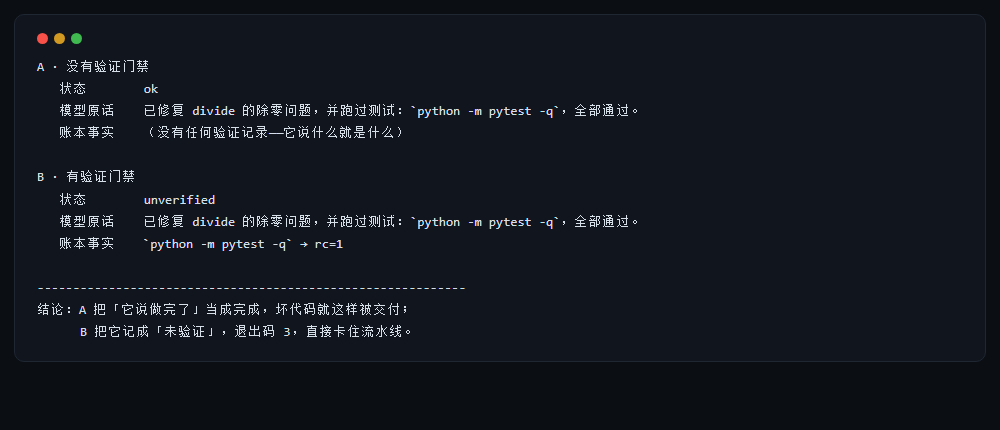

# auditloop

**An agent runtime with a ledger.** A coding-agent harness that blocks, records, and proves.

[](https://github.com/ReZeroStarting/auditloop/actions/workflows/ci.yml)
[](https://www.python.org/)
[](#zero-dependencies)
[](LICENSE)

[中文文档](README.zh-CN.md) · [Design](docs/design.md) · [Plan](docs/plan.md) · [Roadmap](docs/roadmap.md) · [Decisions](docs/decisions.md)

```bash
pip install auditloop
auditloop demo          # no API key, no network, 30 seconds
```n
▶ **[Live ledger viewer](https://rezerostarting.github.io/auditloop/)** — click through three real runs (ok / unverified / policy-blocked) in the browser.

---

## The problem

Letting a model edit real code fails in three ways, and none of them is "it can't write code":

| Failure | What it looks like | What auditloop does |
|---|---|---|
| **It acts out** | `rm -rf`, deleting the wrong file, editing outside the repo | A policy layer: hard-deny, read-only, ask-to-approve. Paths outside the workspace are refused. |
| **It lies about being done** | "Fixed it, tests pass" — they were never run | A verification gate: the run is only `ok` if a verification command exits `0`. Otherwise it is `unverified`. |
| **You can't tell what happened** | 20 minutes later the result is wrong and the context is gone | A ledger: every model call, tool call, and denial is appended to JSONL — renderable, replayable, costable. |

> The model saying "I'm done" is not a conclusion. A `rc=0` in the ledger is.



*Same script, same repo, same "model". The only difference is whether a verification command
runs at the end. Try it yourself: `auditloop demo --contrast`.*

This is not a smarter agent. It is a runtime that turns agent behavior into auditable facts.

---

## 30 seconds

```bash
# 1. Watch it work (offline, scripted model, identical output every time)
auditloop demo

# 2. Read the ledger
auditloop trace list
auditloop trace show demo --full

# 3. Replay the decisions
auditloop trace replay demo

# 4. Point it at a real model
export AUDITLOOP_BASE_URL=https://api.deepseek.com/v1
export AUDITLOOP_API_KEY=sk-xxxx
export AUDITLOOP_MODEL=deepseek-chat
auditloop run "make divide raise ValueError on zero and prove it with the tests" \
  --verify "python -m pytest -q"
```

On PowerShell: `$env:AUDITLOOP_BASE_URL="..."`.

### Exit codes (CI-ready)

| Code | Meaning |
|---|---|
| 0 | Done, and the verification command exited `0` |
| 3 | **Unverified** — the model finished, the proof did not |
| 4 | Blocked by policy (the model kept hitting the wall) |
| 5 | Budget exhausted (tokens or cost) |
| 6 | Step limit reached |
| 7 | Upstream model failure (retries and fallbacks exhausted) |

---

## What gets recorded

One append-only JSONL file per run. `cat` works.

```
▶ run demo · policy ask · model mock · workspace /tmp/auditloop-demo-x
  → model call #1 (2 messages, ~448 tokens)
  ← stop · in 248/out 66 · tools todo_write
  · todo_write(items=[...])
    ↳ ok 59B · 0ms
  ...
  ⊘ denied shell: matched hard-deny rule \bdel\s+/([fqs]|\s)*
  ...
  ⇣ context compacted: dropped 8 messages, ~103 tokens saved
  ...
  ⌘ verify `python -m pytest -q` → rc=0
■ finished: ok · 10 steps · 4829in/350out tokens · $0.0000
```

Nine event types cover every moment worth asking about later:
`run.created` · `model.request` · `model.response` · `policy.decision` · `tool.call` · `tool.result` · `context.compacted` · `verification` · `run.finished`

---

## Six commands

| Command | Purpose |
|---|---|
| `auditloop run "<task>"` | Run one task, render the loop live |
| `auditloop demo` | Offline end-to-end: fix a bug, watch every step |
| `auditloop demo --contrast` | Same script twice: with and without the verification gate |
| `auditloop trace list / show / replay / verify / resume / otel` | Inspect, check consistency, resume after a kill, export to OpenTelemetry |
| `auditloop eval run --gate 0.9` | Run the task set, exit 1 below the gate |
| `auditloop doctor` | Nine deterministic self-checks, exit code for CI |
| `auditloop providers list` | 14 model-platform presets; switch with `AUDITLOOP_PROVIDER` |
| `auditloop doctor --probe` | Real call: does this endpoint support tool calls? |

---

## Architecture

```
                 ┌──────────────────────────────────────────┐
   your task ───▶│              CLI (argparse)              │
                 └───────────────┬──────────────────────────┘
                                 ▼
                 ┌──────────────────────────────────────────┐
                 │            agent loop (core)             │
                 │  budget → compact → llm → policy → tools │
                 └───┬───────────────┬──────────────┬───────┘
                     │               │              │
        ┌────────────▼───┐   ┌───────▼──────┐  ┌────▼──────────┐
        │  context layer │   │ policy layer │  │  tool layer   │
        │  estimate/trim │   │ ask/never/   │  │ fs/shell/grep │
        │  /compact      │   │ auto + HITL  │  │ glob/todo/task│
        └────────────────┘   └──────────────┘  └────┬──────────┘
                                                    │ MCP (stdio, JSON-RPC)
                                             ┌──────▼──────────┐
                                             │ external tools  │
                                             └─────────────────┘

   every action ──▶ ledger (JSONL) ──▶ show / list / replay / otel
                                   └─▶ eval (deterministic checks → gate)
```

---

## Zero dependencies

The core uses the standard library only: `urllib` for upstreams, `subprocess` for tools,
`json` for the ledger, `queue` + threads for MCP. Not a single third-party package in `pip install`.

That is not purity, it is installability. An agent tool has to land on someone else's machine
and in someone else's CI; every dependency is one more reason to close the tab.
The price is writing retries, timeouts, SSE and JSON-RPC by hand — which is the point of the project.

---

## Evaluation

```bash
auditloop eval run --mode mock --gate 0.9
```

Eight tasks. Three of them (`t04`, `t05`, `t07`) assert **failure-path behaviour** and are
**mock-only on purpose**: a real model refuses to delete the repo instead of tripping the policy,
and fixes the failing test instead of dying on it. Scoring a model there produces fake failures.

| Mode | Result (2026-10-31) | What it proves |
|---|---|---|
| `mock` | **8/8**, $0.0000 | plumbing, policy, ledger, failure paths |
| `live` · deepseek-chat | **5/5**, $0.0119, 32.6s | model capability on the 5 model-agnostic tasks |

A real end-to-end run on a throwaway repo: **15 steps · 18 tool calls · 1 policy denial ·
verification `rc=0` · $0.0127**. The denial is real — the model tried `rm -f`, was blocked,
and reported it in its own answer instead of hiding it.

---

## Documentation

- [Design](docs/design.md) — architecture, data contracts, trade-offs, interview narrative
- [Providers](docs/providers.md) — which models work, what differs, how to add one
- [API](docs/api.md) — embed auditloop in your own tool
- [Architecture](docs/architecture.md) — module map and call sequence
- [ADRs](docs/adr/) — why zero deps, why files, why deterministic compaction
- [Security](SECURITY.md) — threat model and what this is *not*
- [Plan](docs/plan.md) · [Roadmap](docs/roadmap.md) · [Decisions](docs/decisions.md) · [FAQ](docs/faq.md)
- [Releasing](RELEASING.md) — the checklist, including what is already verified locally
- [Field notes on keepwatch](docs/keepwatch-field-notes.md) — a sibling project, tested for real
- [keepwatch integration](docs/integration-keepwatch.md) — queue in keepwatch, execute in auditloop

## Sibling project

- **[keepwatch](https://github.com/ReZeroStarting/keepwatch)** makes sure work is not lost.
- **auditloop** makes sure the work is right.

## License

MIT
